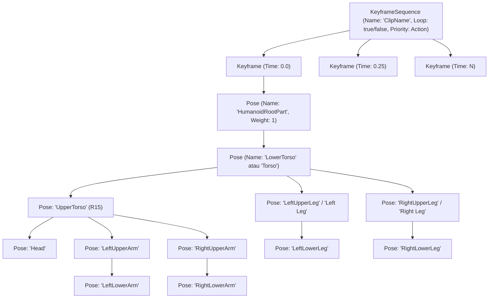
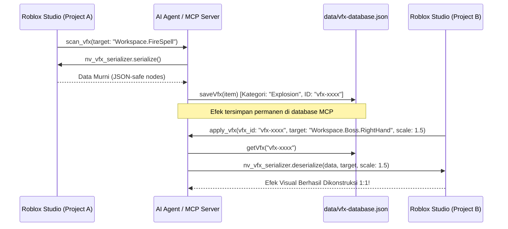

# NVStudio Animation Engine, VFX & Serializer Guide
> **Panduan Mutlak & Ground Truth Anti-Halusinasi AI Agent untuk Pembuatan Animasi, Kinematika IK, dan Efek Visual Lintas-Proyek**

Dokumen ini merupakan referensi resmi (*ground truth*) bagi AI Agent (Antigravity IDE, Cursor, Claude Desktop, Windsurf) dalam mengeksekusi operasi animasi karakter dan pengelolaan efek visual di Roblox Studio menggunakan **nvstudio-mcp**.

---

## 1. Topologi Rig & Standar Penamaan Joint (Sensitivitas Spasi)

Roblox memiliki dua standar rig utama dengan penamaan `Motor6D` yang sangat berbeda. **DILARANG KERAS mencampuradukkan penamaan keduanya.**

### A. Tabel Perbandingan Motor6D: R15 vs R6

| Bagian Tubuh | Motor6D R15 (CamelCase, Tanpa Spasi) | Motor6D R6 (Title Case, DENGAN SPASI) | Batas Sudut Aman (Pitch / Yaw / Roll) |
| :--- | :--- | :--- | :--- |
| **Akar Tubuh (Root)** | `Root` (Part0: HumanoidRootPart, Part1: LowerTorso) | `RootJoint` (Part0: HumanoidRootPart, Part1: Torso) | Bob Y $\pm 0.3$, Tilt $-10^\circ \dots 15^\circ$ |
| **Pinggang / Torso** | `Waist` (Part0: LowerTorso, Part1: UpperTorso) | *(Virtual via R6Controls)* | Pitch $-25^\circ \dots 35^\circ$, Yaw $\pm 45^\circ$, Roll $\pm 15^\circ$ |
| **Leher / Kepala** | `Neck` (Part0: UpperTorso, Part1: Head) | `Neck` (Part0: Torso, Part1: Head) | Pitch $-40^\circ \dots 50^\circ$, Yaw $\pm 70^\circ$, Roll $\pm 25^\circ$ |
| **Bahu Kiri** | `LeftShoulder` (Part0: UpperTorso, Part1: LeftUpperArm) | `Left Shoulder` (Part0: Torso, Part1: Left Arm) | Rentang bebas 3D, hindari rotasi $> 180^\circ$ mendadak |
| **Siku Kiri** | `LeftElbow` (Part0: LeftUpperArm, Part1: LeftLowerArm) | *(Virtual via R6Controls)* | **HANYA Pitch $0^\circ \dots 145^\circ$** (Siku tidak bisa menekuk ke belakang!) |
| **Pergelangan Kiri** | `LeftWrist` (Part0: LeftLowerArm, Part1: LeftHand) | *(Virtual via R6Controls)* | Pitch $\pm 45^\circ$, Yaw $\pm 30^\circ$ |
| **Bahu Kanan** | `RightShoulder` (Part0: UpperTorso, Part1: RightUpperArm) | `Right Shoulder` (Part0: Torso, Part1: Right Arm) | Rentang bebas 3D |
| **Siku Kanan** | `RightElbow` (Part0: RightUpperArm, Part1: RightLowerArm) | *(Virtual via R6Controls)* | **HANYA Pitch $0^\circ \dots 145^\circ$** |
| **Pergelangan Kanan**| `RightWrist` (Part0: RightLowerArm, Part1: RightHand) | *(Virtual via R6Controls)* | Pitch $\pm 45^\circ$, Yaw $\pm 30^\circ$ |
| **Pangkal Paha Kiri** | `LeftHip` (Part0: LowerTorso, Part1: LeftUpperLeg) | `Left Hip` (Part0: Torso, Part1: Left Leg) | Pitch $-90^\circ \dots 50^\circ$, Roll $-15^\circ \dots 45^\circ$ |
| **Lutut Kiri** | `LeftKnee` (Part0: LeftUpperLeg, Part1: LeftLowerLeg) | *(Virtual via R6Controls)* | **HANYA Pitch $0^\circ \dots 135^\circ$** (Lutut hanya menekuk ke belakang!) |
| **Pergelangan Kaki Kiri**| `LeftAnkle` (Part0: LeftLowerLeg, Part1: LeftFoot) | *(Virtual via R6Controls)* | Pitch $-40^\circ \dots 30^\circ$ |
| **Pangkal Paha Kanan**| `RightHip` (Part0: LowerTorso, Part1: RightUpperLeg) | `Right Hip` (Part0: Torso, Part1: Right Leg) | Pitch $-90^\circ \dots 50^\circ$, Roll $-45^\circ \dots 15^\circ$ |
| **Lutut Kanan** | `RightKnee` (Part0: RightUpperLeg, Part1: RightLowerLeg) | *(Virtual via R6Controls)* | **HANYA Pitch $0^\circ \dots 135^\circ$** |
| **Pergelangan Kaki Kanan**| `RightAnkle` (Part0: RightLowerLeg, Part1: RightFoot) | *(Virtual via R6Controls)* | Pitch $-40^\circ \dots 30^\circ$ |

> [!CAUTION]
> **ATURAN MUTLAK SIKU & LUTUT (ANTI-PATAH TULANG / ANTI-DISLOKASI):**
> Siku dan lutut manusia adalah sendi engsel (*hinge joint* 1-DOF).
> - **Siku (`LeftElbow`, `RightElbow`)**: HANYA boleh menekuk pada Pitch ke depan ($0^\circ \dots 145^\circ$). **MUTLAK DILARANG SUDUT NEGATIF** ($< 0^\circ$) yang menyebabkan hiperekstensi siku / patah ke belakang. Jangan pernah memberikan rotasi Roll atau Yaw.
> - **Lutut (`LeftKnee`, `RightKnee`)**: HANYA boleh menekuk pada Pitch ke belakang ($0^\circ \dots 135^\circ$). **MUTLAK DILARANG SUDUT NEGATIF** ($< 0^\circ$) yang menyebabkan lutut patah ke depan (dislokasi patela). Jangan pernah memberikan rotasi Roll atau Yaw.

### B. Prinsip Efisiensi Sendi & Isolasi Gerakan (Intentional vs Spastic Motion)
Animasi karakter yang baik meniru prinsip biomekanik manusia:
1. **Isolasi Sendi (Primary vs Secondary Movers)**:
   - Gerakkan HANYA sendi-sendi yang relevan secara fungsional dengan aksi yang diminta.
   - **DILARANG menggerakkan sendi tubuh secara serampangan/acak (*anti-spastic flailing*)**.
   - *Contoh Pukulan*: Gerakkan lengan pemukul dan sedikit rotasi pinggang ($10^\circ \dots 15^\circ$) untuk transfer daya kinetik. Lengan satunya tetap dalam pose pertahanan (*guard pose*) tanpa mengejang, dan kedua kaki tetap menapak stabil.
   - *Contoh Tebasan*: Ayunan senjata fokus pada bahu dan lengan; jangan memutar pergelangan kaki atau menggelengkan kepala tanpa tujuan.
2. **Kestabilan Titik Berat & Pijakan Kaki (*Foot-Planting & Grounding*)**:
   - Kaki penopang yang menyentuh lantai tidak boleh bergeser (*sliding*), melayang (*floating*), atau amblas ke tanah (*ground clipping*).
   - `HumanoidRootPart` / `Root`: Bobbing vertikal harus proporsional ($\pm 0.1 \dots 0.2$ stud). Dilarang membuat karakter melayang naik-turun ekstrem yang merusak gravitasi.

---

## 2. Struktur Resmi KeyframeSequence Roblox

Animasi resmi Roblox **BUKAN script pergerakan runtime dengan `task.wait()`**, melainkan sebuah aset instance `KeyframeSequence` yang disimpan di dalam `AnimSaves` rig karakter.



---

## 3. Tool Pembuatan Animasi (`animate_character`)

### A. Aksi Bawaan (Standard Presets)
Panggil `animate_character` dengan parameter `action` yang didukung:
- `"walk_cycle"`: Langkah kaki seimbang, bobbing vertikal torso, ayunan lengan berlawanan.
- `"melee_slash"`: Fase wind-up (ancang-ancang belakang), percepatan tebasan menyilang, dan peredaman follow-through.
- `"punch"`: Pukulan dorong ke depan dengan pemanfaatan LimbIK dan putaran bahu.
- `"idle_breath"`: Siklus pernapasan dada naik-turun halus (0.04 stud) dengan jeda kepala.

### B. Format Payload Custom Action
Jika Anda membutuhkan animasi kustom, gunakan `action: "custom"` dengan struktur `key_poses`:
```json
{
  "target": "Workspace.Dummy",
  "action": "custom",
  "parameters": {
    "duration": 1.2,
    "easing": "CubicInOut",
    "loop": false,
    "clipName": "CustomSpellCast"
  },
  "key_poses": [
    {
      "time": 0.0,
      "poses": {
        "Waist": { "angles": [0, 0, 0] },
        "RightShoulder": { "angles": [10, 0, 5] }
      }
    },
    {
      "time": 0.5,
      "poses": {
        "Waist": { "angles": [-15, 0, 0] },
        "RightShoulder": { "angles": [120, 20, 0] },
        "LeftShoulder": { "angles": [120, -20, 0] }
      }
    },
    {
      "time": 1.2,
      "poses": {
        "Waist": { "angles": [0, 0, 0] },
        "RightShoulder": { "angles": [10, 0, 5] }
      }
    }
  ]
}
```

---

## 4. Analytical LimbIK Solver (`solve_limb_ik`)

Gunakan saat ingin mengarahkan tangan memegang target atau kaki menapak ke titik dunia tertentu secara instan $O(1)$:
```json
{
  "target": "Workspace.Dummy",
  "limb": "RightArm",
  "goal": [15.2, 5.0, -22.4],
  "pole": [16.5, 6.0, -20.0],
  "apply_to_rig": true
}
```
Solver menggunakan Hukum Cosinus sudut tertutup dan algoritma SoftIK untuk mencegah jitter.

---

## 5. Spesifikasi Serializer VFX Murni (`nv_vfx_serializer`)

Roblox DataModel memiliki tipe data kompleks yang tidak dapat disimpan langsung di JSON. Modul `nv_vfx_serializer` memetakan tipe-tipe tersebut ke skema tabel murni berikut:

| Tipe Roblox | Representasi Serializer Pure Table | Contoh Nilai |
| :--- | :--- | :--- |
| `ColorSequence` | `{ t = "ColorSequence", v = [ [time, { t = "Color3", v = [r,g,b] }], ... ] }` | Minimal 2 keypoint pada $t=0.0$ dan $t=1.0$ |
| `NumberSequence`| `{ t = "NumberSequence", v = [ [time, value, envelope], ... ] }` | Minimal 2 keypoint pada $t=0.0$ dan $t=1.0$ |
| `NumberRange` | `{ t = "NumberRange", v = [min, max] }` | `{ t = "NumberRange", v = [0.5, 1.5] }` |
| `CFrame` | `{ t = "CFrame", v = [c1, c2, c3, c4, c5, c6, c7, c8, c9, c10, c11, c12] }` | 12 komponen matriks transformasi |
| `Vector3` | `{ t = "Vector3", v = [x, y, z] }` | `{ t = "Vector3", v = [0, 5, 0] }` |
| `Vector2` | `{ t = "Vector2", v = [x, y] }` | `{ t = "Vector2", v = [180, 180] }` |
| `Color3` | `{ t = "Color3", v = [r, g, b] }` | Komponen warna $0.0 \dots 1.0$ |
| `EnumItem` | `{ t = "EnumItem", e = "NamaEnumGroup", v = "NamaItem" }` | `{ t = "EnumItem", e = "NormalId", v = "Top" }` |
| `Attachment Ref`| `{ t = "Ref", v = nodeIndexInteger }` | Menghubungkan `Beam.Attachment0` ke index node Attachment |

> [!IMPORTANT]
> **ATURAN MUTLAK ATTACHMENT PADA BEAM & TRAIL:**
> Properti `Attachment0` dan `Attachment1` pada `Beam` atau `Trail` **HANYA BOLEH menunjuk ke instance bertipe `Attachment`**. Dilarang keras menunjuk ke `Part`, `Model`, atau string nama.

---

## 6. Alur Kerja VFX Lintas-Proyek (Scan $\rightarrow$ Database $\rightarrow$ Apply)



---

## 7. Jebakan Halusinasi yang Wajib Dihindari (Anti-Patterns)

1. **DILARANG membuat script Luau loop `while true do part.CFrame = ...`** saat user meminta animasi karakter. Gunakan `animate_character` yang menghasilkan `KeyframeSequence` resmi.
2. **DILARANG membuat animasi dengan sendi patah tulang / dislokasi** (seperti sudut siku atau lutut negatif $< 0^\circ$, memutar Roll/Yaw pada siku/lutut, atau rotasi bahu/paha $> 180^\circ$).
3. **DILARANG menggerakkan sendi yang tidak perlu secara spastik (*no spastic flailing*)**. Hanya manipulasi sendi yang relevan secara biomekanik dengan aksi utama, dan pertahankan tumpuan kaki (*foot-planting*).
4. **DILARANG MERANCANG VFX SEBAGAI SCRIPT HARDCODED**. Seluruh efek visual (`ParticleEmitter`, `Beam`, `Attachment`, `PointLight`, `Sound`) WAJIB berupa Instance Roblox konkret di DataModel (misal `ReplicatedStorage.VFX` atau Attachment rig) menggunakan tool MCP (`batch_create_instances`, `create_instance`, `apply_vfx`). Script Luau HANYA boleh bertindak sebagai trigger pemicu (`:Clone()`, `:Emit()`, `Enabled = true`, `Debris:AddItem`).
5. **DILARANG memanggil `solve_limb_ik` dengan koordinat di luar jangkauan rig** tanpa pole vector atau memutar siku ke belakang ($< 0^\circ$).
6. **DILARANG membuat `ColorSequence` atau `NumberSequence` tanpa keypoint awal ($t=0$) dan akhir ($t=1$)**. Roblox Engine akan melempar error runtime instan jika keypoint $0$ atau $1$ tidak didefinisikan.
7. **DILARANG menggunakan string part path pada `Beam.Attachment0`**. Beam wajib mengacu pada instance `Attachment`.
8. **DILARANG menebak nama joint R6 tanpa spasi**. R6 selalu menggunakan spasi: `"Left Arm"`, `"Left Shoulder"`, `"Torso"`, `"RootJoint"`.

