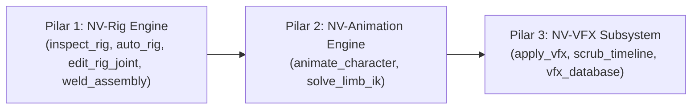

# 🛠️ Panduan Teknis & Anti-Halusinasi: NV-Rig Engine (Headless Modular Command Dispatcher)

Dokumen ini adalah **panduan resmi (ground truth)** bagi pengembang dan AI Agent untuk mengoperasikan sistem rigging Roblox secara headless menggunakan **NV-Rig Engine**. Dokumen ini terintegrasi langsung dengan **NV-Animation Engine** dan **NV-VFX Subsystem** di dalam ekosistem `nvstudio-mcp`.

---

## 1. Filosofi & Hubungan Tripartit Sistem NV-Series

Ekosistem karakter dan animasi di `nvstudio-mcp` beroperasi dalam 3 pilar yang saling berurutan:



1. **Pilar 1 (NV-Rig Engine)**: Membangun fondasi sendi fisik (`Motor6D` / `Weld`), menentukan hierarki pohon tubuh, menyesuaikan titik poros putar (*pivot*) dengan kompensasi $C_0/C_1$, dan meng-unanchor part.
2. **Pilar 2 (NV-Animation Engine)**: Menghasilkan `KeyframeSequence` resmi di `AnimSaves`, menginterpolasi kurva Cubic Bezier, dan menyelesaikan inverse kinematics analitis (2-link LimbIK).
3. **Pilar 3 (NV-VFX Subsystem)**: Melampirkan `KeyframeMarker` pada timestamp tebasan/pukulan, menyambungkan partikel/beam, dan melakukan verifikasi scrubbing.

> [!IMPORTANT]
> **Kaidah Utama**: Jangan pernah memanggil `animate_character` pada model yang belum memiliki struktur `Motor6D` yang valid! Selalu jalankan `inspect_rig` atau `auto_rig` terlebih dahulu.

---

## 2. Matematika Kinematika Sambungan Roblox (Ground Truth)

### A. Persamaan Kesetaraan Sambungan
Roblox Engine mempertahankan posisi relatif antara dua bagian fisik yang terhubung melalui persamaan:
$$\text{Part0.CFrame} \times C_0 = \text{Part1.CFrame} \times C_1$$

- **`Part0`**: Bagian induk (*Parent / Root*).
- **`Part1`**: Bagian anak (*Child / Connected Part*).
- **`C0`**: Transformasi offset dari origin `Part0` ke titik tumpu poros (*pivot*).
- **`C1`**: Transformasi offset dari origin `Part1` ke titik tumpu poros (*pivot*).

### B. Hukum Kompensasi Poros Tanpa Dislokasi (*Non-Dislocation Law*)
Jika Anda hanya mengubah $C_0$ secara sepihak, posisi `Part1` akan terlempar atau mengalami *snap* di dunia 3D. 
Agar `Part1` **tetap diam 100% di posisi fisiknya di dunia**, nilai $C_1$ **WAJIB dikompensasi secara simultan**:

1. Hitung titik target poros di dunia:
   $$\vec{P}_{\text{target}} = (\text{Part0.CFrame} \times C_{0\text{old}}) + \Delta \vec{w}$$
2. Hitung $C_0$ baru dalam koordinat lokal `Part0`:
   $$C_{0\text{new}} = \text{Part0.CFrame:ToObjectSpace}(\vec{P}_{\text{target}})$$
3. Hitung selisih transformasi (*difference*):
   $$\text{diff} = C_{0\text{old}}\text{:ToObjectSpace}(C_{0\text{new}})$$
4. Kalikan selisih diff ke $C_1$ lama:
   $$C_{1\text{new}} = C_{1\text{old}} \times \text{diff}$$

Sistem `nv_joint_math` dan tool `edit_rig_joint` menerapkan rumus ini secara otomatis.

### C. Aturan Wajib Unanchor
Part anak (`Part1`) yang digerakkan oleh `Motor6D` atau `Weld` **DILARANG KERAS** berstatus `Anchored = true`. Jika `Part1.Anchored == true`, fisika dan animasi Roblox tidak akan pernah menggerakkan part tersebut.
Tool `auto_rig`, `create_joint`, dan `weld_assembly` otomatis menyetel `Part1.Anchored = false`.

---

## 3. Sensitivitas Huruf Besar/Kecil & Hierarki Pohon Avatar

### Standar Rig R15 (CamelCase Tanpa Spasi)
```
HumanoidRootPart
 └── LowerTorso (Motor: "Root")
      ├── UpperTorso (Motor: "Waist")
      │    ├── Head (Motor: "Neck")
      │    ├── LeftUpperArm (Motor: "LeftShoulder")
      │    │    └── LeftLowerArm (Motor: "LeftElbow")
      │    │         └── LeftHand (Motor: "LeftWrist")
      │    └── RightUpperArm (Motor: "RightShoulder")
      │         └── RightLowerArm (Motor: "RightElbow")
      │              └── RightHand (Motor: "RightWrist")
      ├── LeftUpperLeg (Motor: "LeftHip")
      │    └── LeftLowerLeg (Motor: "LeftKnee")
      │         └── LeftFoot (Motor: "LeftAnkle")
      └── RightUpperLeg (Motor: "RightHip")
           └── RightLowerLeg (Motor: "RightKnee")
                └── RightFoot (Motor: "RightAnkle")
```

### Standar Rig R6 (Menggunakan Spasi)
```
HumanoidRootPart
 └── Torso (Motor: "RootJoint")
      ├── Head (Motor: "Neck")
      ├── Left Arm (Motor: "Left Shoulder")
      ├── Right Arm (Motor: "Right Shoulder")
      ├── Left Leg (Motor: "Left Hip")
      └── Right Leg (Motor: "Right Hip")
```

---

## 4. Katalog Semantic MCP Tools untuk AI Agent

### 1. `inspect_rig`
Memeriksa struktur pohon sendi dan melakukan diagnosa kesehatan rig secara headless.
```json
{
  "target": "Workspace.Dummy"
}
```
**Output Diagnostik:**
- Jumlah total part & joint (`Motor6D` vs `Weld`).
- Daftar part yang masih `Anchored` (penyebab umum animasi macet).
- Deteksi siklus tertutup (*circular dependency*).
- Calon Root Part utama.
- Posisi koordinat dunia absolut untuk setiap pivot poros sendi.

---

### 2. `auto_rig`
Auto-rigging cerdas 1-klik yang secara instan merangkai seluruh Motor6D avatar atau menautkan senjata.
```json
// Contoh Auto-Rig R15:
{
  "target": "Workspace.CharacterModel",
  "rig_type": "R15"
}

// Contoh Auto-Rig R6:
{
  "target": "Workspace.ClassicNoob",
  "rig_type": "R6"
}

// Contoh Penautan Senjata (Weapon Grip):
{
  "target": "Workspace.CharacterModel",
  "rig_type": "Weapon",
  "weapon_target": "Workspace.Katana",
  "target_limb": "RightHand"
}
```

---

### 3. `edit_rig_joint`
Manipulasi sendi individual presisi tinggi (membuat, memindahkan poros, memutar, mereset, atau menghapus).

```json
// Contoh: Geser poros bahu ke atas sebesar 0.5 stud di dunia nyata
{
  "target": "Workspace.CharacterModel",
  "action": "edit_pivot",
  "joint_name": "RightShoulder",
  "delta_world": [0, 0.5, 0]
}

// Contoh: Buat Motor6D baru antara Torso dan Sayap
{
  "target": "Workspace.CharacterModel",
  "action": "create_joint",
  "joint_name": "LeftWingJoint",
  "part0": "UpperTorso",
  "part1": "LeftWing"
}

// Contoh: Reset poros kembali ke origin part anak
{
  "target": "Workspace.CharacterModel",
  "action": "reset_pivot",
  "joint_name": "LeftWingJoint"
}
```

---

### 4. `weld_assembly`
Mengelas seluruh komponen model prop, helm, armor, atau kendaraan ke satu titik tumpu utama secara atomik.
```json
{
  "target": "Workspace.CyberArmorSet",
  "primary_part": "Chestplate"
}
```

---

### 5. `mirror_rig`
Mencerminkan seluruh konfigurasi sendi bilateral dari sisi kiri ke sisi kanan (atau sebaliknya) secara matematis pada sumbu simetri $X$.
```json
{
  "target": "Workspace.CustomMech",
  "source_side": "Left"
}
```

---

## 5. Alur Kerja End-to-End: Dari Model Mentah Menjadi Animasi & VFX Siap Main

Berikut alur kerja standar bagi AI Agent saat diminta membuat animasi pertarungan dari nol:

```
[Langkah 1: Inspeksi Model Mentah]
└── Panggil tool `inspect_rig` pada "Workspace.Fighter"
    └── Temukan apakah part sudah memiliki Motor6D atau masih mentah.

[Langkah 2: Bangun Struktur Rig]
└── Jika belum memiliki joint, panggil `auto_rig` dengan "R15" atau "R6".
└── Jika ada senjata/pedang, panggil `weld_assembly` pada pedang lalu panggil `auto_rig` mode "Weapon".

[Langkah 3: Perhalus Poros Sendi (Bila Perlu)]
└── Jika pivot siku atau bahu berada di titik yang kurang pas, panggil `edit_rig_joint` (action: "edit_pivot").

[Langkah 4: Fabrikasi Animasi Halus]
└── Panggil `animate_character` dengan parameter:
    • action: "melee_slash"
    • parameters: { "duration": 0.8, "vfx_events": [{ "time": 0.35, "marker_name": "VFX", "value": "SlashBurst" }] }

[Langkah 5: Terapkan Efek Visual Portabel]
└── Panggil `apply_vfx` dengan:
    • vfx_id: "preset-cyan-slash"
    • target: "Workspace.Fighter.RightHand"
    • scale: 1.2

[Langkah 6: Validasi Playhead]
└── Panggil `scrub_timeline` ke t=0.35s untuk memverifikasi pose tebasan dan burst partikel di Studio Viewport.
```

Dengan protokol ini, AI Agent dapat menyelesaikan kebutuhan rigging dan animasi apa pun secara mandiri, deterministik, dan tanpa halusinasi!

